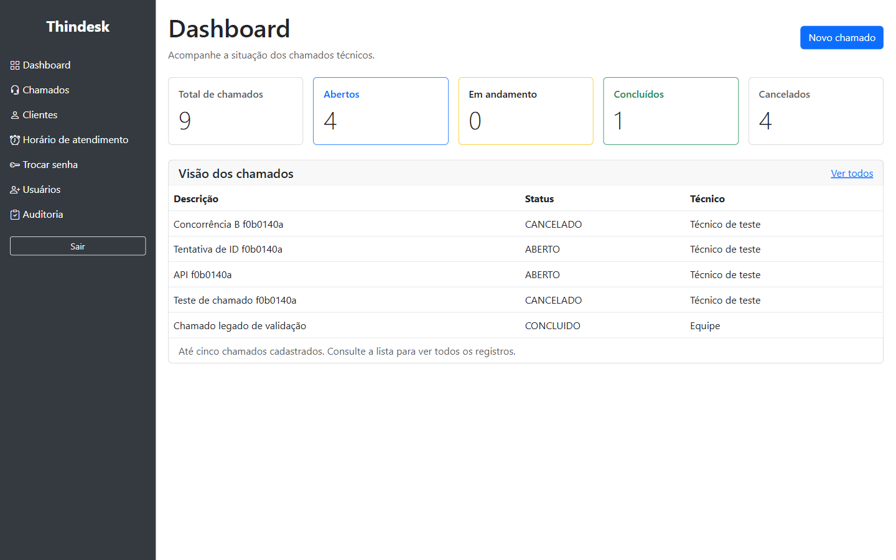

# Thindesk

Sistema de controle de chamados técnicos desenvolvido com Java 21, Spring Boot 3.4.0, Thymeleaf, Bootstrap e MongoDB.

## Funcionalidades

- Login e logout, com aceite dos documentos legais no primeiro acesso.
- Cadastro, consulta e edição de chamados pela interface.
- Status: Aberto, Em andamento, Concluído e Cancelado.
- Cancelamento que mantém o chamado para consulta.
- Detecção de conflitos entre edição e cancelamento de chamados.
- Cadastro, edição e exclusão de clientes.
- Cadastro e exclusão de horários de atendimento por setor.
- Dashboard com total de chamados e contagem por status, calculados a partir do banco.
- Validação dos campos, proteção CSRF e controle de acesso por perfil.
- Gestão de usuários e redefinição de senha pelo administrador, com auditoria.
- Encerramento de sessões antigas após troca ou redefinição de senha.

| Perfil | Acesso aos chamados |
| --- | --- |
| Administrador | Consultar, cadastrar, editar e cancelar; também cadastra usuários. |
| Operador | Consultar, cadastrar, editar e cancelar. |
| Professor | Consultar a lista e o dashboard. |

Administradores e operadores também podem cadastrar, editar e excluir clientes e cadastrar ou excluir horários. Professores podem consultar esses registros. A gestão de usuários e a auditoria são restritas ao administrador.

## Recuperar acesso e trocar senha

A opção **Esqueceu sua senha?** orienta a procurar o administrador da instituição. Não há envio de e-mail nem geração pública de links de recuperação.

Para redefinir a senha de outra conta, o administrador deve abrir **Usuários → Redefinir senha**, confirmar a identidade da pessoa, informar sua própria senha e definir uma nova senha para ela. A nova senha deve ser entregue por um canal privado; ela não é exibida depois de salvar.

Depois de entrar, o usuário pode escolher sua senha em **Trocar senha**, informando a senha atual. O administrador também usa essa opção para a própria conta. A alteração exige ao menos oito caracteres e respeita o limite de entrada do BCrypt, sem truncar a senha.

Trocas e redefinições invalidam as sessões anteriores na próxima requisição, inclusive acessos à API. Uma operação que já estava em execução pode terminar. Os antigos endereços de recuperação por token retornam HTTP 410 e não alteram senhas; não é necessário apagar coleções antigas para desativá-los.

Se o único administrador perder o acesso, será necessária uma intervenção do responsável pelo ambiente no banco. A aplicação não oferece recuperação pública dessa conta.

## Alterações simultâneas em chamados

Cada chamado possui uma `revisao`. A interface envia esse valor ao editar ou cancelar. Se outra operação já alterou o chamado, a aplicação retorna HTTP 409, mantém o texto digitado e pede que os dados sejam recarregados antes de salvar.

O `PUT /api/chamados/{id}` também exige a `revisao` recebida na consulta, junto dos campos do chamado. Omitir a revisão retorna HTTP 400; usar uma revisão antiga retorna HTTP 409. Registros anteriores sem esse campo são lidos como revisão zero e recebem a primeira revisão ao serem alterados, sem migração prévia.

Clientes não possuem detecção de conflito entre duas edições. Uma edição, porém, não recria um cliente que tenha sido excluído por outra operação.

## Versão e semântica de versionamento

Versão atual: **`1.0.0-beta`**, definida no `pom.xml`.

O projeto adota o formato `MAJOR.MINOR.PATCH`, com um sufixo opcional de pré-lançamento:

- **MAJOR:** alterações incompatíveis com a versão anterior.
- **MINOR:** novas funcionalidades compatíveis.
- **PATCH:** correções compatíveis.
- **`-beta`:** versão de pré-lançamento, ainda em preparação para a entrega.

Nesta versão, `1` identifica a primeira versão principal; os dois zeros indicam que ainda não houve incrementos de funcionalidades ou correções após essa base. A versão final poderá ser identificada como `1.0.0` depois da validação da entrega e do deploy.

## Dashboard

Captura da aplicação executando localmente, com dados fictícios de validação persistidos no MongoDB. As quantidades variam conforme os chamados cadastrados.



## Executar localmente

Requisitos: JDK 21 ou superior e MongoDB disponível. O Maven Wrapper acompanha o projeto; não é necessário instalar Maven separadamente.

Por padrão, a aplicação conecta em `mongodb://localhost:27017/thindesk` e abre em <http://localhost:8080>.

No PowerShell:

```powershell
.\mvnw.cmd spring-boot:run
```

No Linux ou macOS:

```sh
sh mvnw spring-boot:run
```

Em um banco novo, a conta administradora local padrão é `admin`, com senha `thindesk123`. Essas credenciais são apenas para desenvolvimento local. As variáveis abaixo permitem definir outro acesso antes da primeira inicialização.

| Variável | Finalidade | Padrão local |
| --- | --- | --- |
| `MONGODB_URI` | Endereço de conexão do MongoDB | `mongodb://localhost:27017/thindesk` |
| `MONGODB_DATABASE` | Nome do banco | `thindesk` |
| `PORT` | Porta HTTP | `8080` |
| `APP_ADMIN_USERNAME` | Nome da conta administradora inicial | `admin` |
| `APP_ADMIN_PASSWORD` | Senha da conta administradora inicial | `thindesk123` |
| `APP_ADMIN_EMAIL` | E-mail da conta administradora inicial | `admin@thindesk.local` |
| `APP_ADMIN_NOME` | Nome da conta administradora inicial | `Administrador` |

A conta inicial só é criada se o nome de usuário ainda não existir. Alterar as variáveis depois disso não muda a senha de uma conta já cadastrada. Na primeira entrada, aceite os documentos legais para acessar o dashboard.

As variáveis devem estar no ambiente do processo; a aplicação não carrega arquivos `.env` automaticamente.

## Gerar o executável

```powershell
.\mvnw.cmd package
java -jar target/thindesk-1.0.0-beta.jar
```

O JAR contém as dependências e os arquivos da interface. O MongoDB permanece como um serviço externo ao JAR.

## Verificar o fluxo integrado

O comando abaixo usa Node.js 22 ou superior, sem pacotes adicionais. Ele acessa uma aplicação real e cria chamados e usuários de teste; execute em uma instância local com banco separado dos dados de uso.

Exemplo para iniciar uma instância de testes com um MongoDB local já disponível:

```powershell
$env:MONGODB_URI='mongodb://localhost:27017/thindesk_validacao'
$env:MONGODB_DATABASE='thindesk_validacao'
$env:PORT='8081'
.\mvnw.cmd spring-boot:run
```

Em outro terminal, informe o endereço e a senha do administrador dessa instância:

```powershell
$env:THINDESK_TEST_URL='http://127.0.0.1:8081'
$env:THINDESK_TEST_ADMIN='admin'
$env:THINDESK_TEST_PASSWORD='thindesk123'
node scripts/verificar-fluxo.mjs
```

O script verifica chamados, conflitos entre operações, clientes, horários, cadastro de usuários, recuperação administrada de acesso, troca de senha, bloqueio após tentativas incorretas, revogação de sessões, auditoria, CSRF, permissões e contadores do dashboard. Os dados gerados permanecem no banco de testes. Esse comando valida o fluxo por HTTP; a inspeção visual deve ser feita no navegador.

## Deploy e entrega acadêmica

**Deploy público: pendente.** O endereço local não substitui o link público exigido na atividade.

Repositório individual: [PietroNozella/thindesk-chamados — branch feat/entrega-final](https://github.com/PietroNozella/thindesk-chamados/tree/feat/entrega-final).
Essa branch contém a aplicação com interface desta entrega. A `main` conserva a atividade anterior de API.

Para concluir a entrega:

- Hospedar o JAR em um ambiente com Java 21 ou superior e configurar a conexão ao MongoDB e a conta administradora inicial.
- Criar uma conta de demonstração com perfil Operador em **Usuários → Cadastrar usuário**.
- Registrar aqui o endereço público e as credenciais de demonstração, sem expor a conta administradora ou as credenciais do banco.
- Testar o login e o fluxo de chamados pelo endereço público em janela anônima.
- Conferir que o código do GitHub, a aplicação publicada e o ZIP solicitado correspondem à mesma versão.

| Item da entrega | Situação |
| --- | --- |
| GitHub individual | Versão com interface na branch `feat/entrega-final`, no link acima |
| Versão e explicação | Documentadas neste README |
| Print do dashboard | Incluído acima |
| Link do deploy | Pendente |
| Credenciais de demonstração do deploy | Pendentes |
